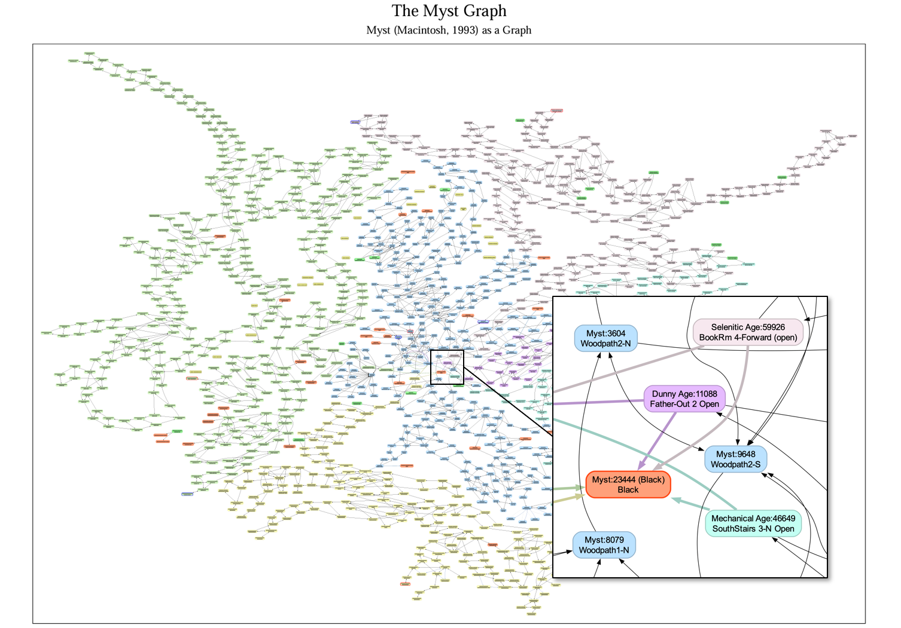

# DeMystify



DeMystify is an unofficial open-source project graph-based analysis of the classic Myst games. In other words, it represents them as graphs: Myst and Riven with the Go command of this repository, Myst III: Exile and Myst IV: Revelation with the Python extractors of [`exile/`](exile/README.md) and [`revelation/`](revelation/README.md).

## The Myst Graph

The Myst Graph represents the game's cards as a network showing how they are connected. The generated full graph contains 1,364 nodes and 3,244 non-disabled directed connections, before reverse pairs are combined for display. Counts can vary with the input files.

A handler that requests several cards in a row keeps one connection from its own card to each of them. For two successive literal `go` commands through an intermediate view, that is `start → intermediate` and `start → destination`. The step `intermediate → destination` is recorded as well, as an automatic next step. It is drawn with a hollow arrowhead, and it keeps a view that the player only passes through from looking like a dead end. Where an ordinary connection joins the same two cards in the same direction, both share one line: the filled arrowhead comes first and the hollow one follows it. Path search does not follow these steps, so one click is never counted as several, and a view shared by several callers does not connect one caller to another's destination. They are distinct from saved push/pop returns. A sequence continues through the display, sound and wait commands of the shared Myst player, inside one branch of a condition or one loop body, and past the `end if` of the branch it is in. A condition, an `else`, a loop boundary, an exit, a `go` that only redisplays the current card and any other command or call end it. A handler is not read as a sequence at all when it holds a saved return, a continued line or a `go` that could leave the stack.

The analysis extracts links from supported HyperTalk commands without executing the scripts. A commented-out command is kept as a disabled connection. So is the body of a handler whose declaration line was commented out while the rest was left in place: it belongs to no handler, and HyperCard never runs it. Shortest paths describe the static card graph and exclude disabled edges, backtracking edges and automatic next steps. They do not simulate puzzle conditions, variables, or the HyperCard return stack; restrictive-transitivity IDs associate edges visually rather than enforce stateful navigation. A graph path therefore does not guarantee a playable route through the game.

A reference can also be in the files without any click being able to reach it: the part that holds it lies entirely under a later button of the same card, which takes every click. HyperCard sends a click to the topmost part, and a part without a handler passes it to the card, never to the part beneath. Such a reference is kept as a shadowed connection, drawn as a dotted grey line with a grey arrowhead and, like a disabled one, left out of the graph on which paths, sources and sinks are computed. The proof is deliberately narrow: the cover is one later button, stored visible and enabled, and no script that can run on the card may hide, show, move, disable or message either part, unless it names another part by a quoted name, an id or a number. A covered copy of a reference that a reachable part repeats is not recorded. The six stacks hold one shadowed connection, from Myst:89742 to Myst:88832.

In the same way, a sink flag means that no outgoing connection was extracted, not that the player is stuck. A close-up that is left through a saved return carries it, and so does a view that a script shows and then leaves through a helper handler, after other commands, or on the way to another stack.

## Generate the Myst Graph

### Prerequisites

*   A 1993 Myst CD-ROM (Macintosh)
*   [Go](https://go.dev/doc/install)
*   [Neato](https://graphviz.org/docs/layouts/neato/) for PDF output and PDF-style browser placement; the built-in image atlas and DOT output work without it

Copy the six HyperCard stacks from the CD-ROM's `Myst Files` directory: `Channelwood Age`, `Dunny Age`, `Mechanical Age`, `Myst`, `Selenitic Age` and `Stoneship Age`. DeMystify reads these files directly into Go objects; no conversion tool or intermediate XML is required.

The native reader supports HyperCard 2.x format 10 data forks. It loads card and background identities, original card order, field text and stack/card/background/part HyperTalk scripts. It validates block boundaries and references and reports skipped blocks through `hypercard.Stack.Diagnostics`.

It does not decode artwork, audio or movies, execute scripts, decrypt encrypted stacks, or open ISO/HFS images and MacBinary wrappers. OSA scripts are unsupported. Resource forks are unnecessary for the static graph. Neato is used to lay out and render the PDF.

### Generate the Myst Graph

1.  **Navigate to the DeMystify directory**
2.  **Run DeMystify:**

    ```bash
    $ go run . "/path/to/Myst Files"
    ```

    *   Use the directory containing the six original stacks. Previously converted XML stack directories remain supported and are detected automatically. If both input formats are present, select a directory containing only the format you want to use.
3.  **Wait:** The graph generation process takes several minutes.
4.  **The Myst Graph is generated:** DOT and PDF are saved in `generated`; open `generated/web/index.html` for the browser viewer. The run also prints the number of records, the source, sink and isolated flags, and the largest shortest distance with its two cards.

For programmatic use, `hypercard.ReadFile(path)` returns a decoded stack and `parser.NewParser(path)` accepts either a single native stack or a directory. `parser.LoadInput(path)` exposes the complete input model, including source offsets and diagnostics; `parser.NewParserFromCorpus(corpus)` analyzes an in-memory model without reopening its source files. The command above expects the complete six-stack Myst dataset.

### Explore in a browser

Generate the browser output with your decoded view images:

```bash
go run . --format html --assets "/path/to/views" "/path/to/Myst Files"
```

Open `generated/web/index.html` directly in your browser. The viewer works offline, with no server, CDN or JavaScript package installation. Scroll or pinch to zoom, drag to pan, use the zoom/fit controls, filter by Age, or search for a card ID, name or picture name. Zooming into the graph reveals view thumbnails inside its nodes. Selecting a card opens its larger view and incoming/outgoing connections.

When Neato is installed, the browser starts with the PDF graph's organic placement, routed connections, arrow shapes and colors. Switch between **PDF graph** and **Image atlas** in the viewer. In the PDF view, the **Images** control switches between compact thumbnails and the original graph labels, retaining the same node boxes and positions. Card pictures and interaction zones remain available in the side panel in both views.

Saved-return entries use the PDF's inverted arrowheads at both ends, including in the image atlas. They mark extracted push/pop navigation, such as entering a close-up with a saved return; they do not add an unconditional reverse connection to the graph. Automatic next steps end in a hollow arrowhead in both views; in the PDF view, a step that shares its line with an ordinary connection shows the hollow arrowhead behind the filled one.

Use **Highlight nodes** to emphasize sources, sinks, isolated nodes, active self-references, page cards, absent targets or stacks. Multiple categories combine with OR. Other nodes stay in place and turn gray, along with their unrelated connections; they remain selectable and searchable. Clearing the highlights restores the normal colors. Age visibility controls remain independent.

`--web-layout auto` is the default: use the PDF drawing when Neato is available, otherwise the built-in image atlas. Choose `--web-layout pdf` to require the PDF-style graph or `--web-layout atlas` to generate HTML without Neato. For example:

```bash
go run . --format html --web-layout pdf --assets "/path/to/views" "/path/to/Myst Files"
```

The default `--layout original` preserves the original organic graph arrangement. An optional `--layout ages` arrangement separates Ages, chooses between two organic placements to reduce crossings within each Age, and keeps small disconnected components near their own Age. This option controls the PDF and the browser's **PDF graph** together; the built-in **Image atlas** keeps its separate placement. DOT-only generation skips placement.

When HTML and PDF are generated together, both use the same Graphviz layout pass, including node boxes, curved connections and arrowheads. The PDF contains labels; the browser can display pictures inside those same boxes. The browser stores its drawing locally and needs no Graphviz installation when opened.

Enable **Interactive zones** on the selected view to inspect card and background buttons and fields. Select a zone to read its stored name, visibility/enabled flags and HyperTalk script. These are the geometry and flags saved in the stack; scripts can change them at runtime. The viewer inspects the static graph and does not execute the game.

`--format all` (the default) produces HTML, PDF and DOT. `--format pdf` produces PDF and DOT; `--format dot` produces DOT alone. Use `--web-output /path/to/viewer` to choose the browser export directory. Without `--assets`, the viewer still provides the graph and interactive geometry, with missing views explicitly identified.

The default `generated/web` export is ignored by Git because it contains local game imagery and scripts. Original assets are not included in the repository. Keep custom export/image directories outside Git or in an ignored local directory.

The image directory can contain PNG, JPEG or GIF files. Stack subdirectories scope picture filenames and `card_<id>` filenames. For exact mappings, add an `images.json` file; its paths are relative to that directory:

```json
{"images":[
  {"node":"Example Age:1","path":"views/start.png"},
  {"stack":"Example Age","picture":"Courtyard-N","path":"views/courtyard.png"}
]}
```

When a manifest is present, it defines the mappings. Ambiguous images stay unmapped and are reported. Matching pictures are copied and deduplicated into the browser export, with smaller thumbnails loaded as they enter the viewport. The originals remain unchanged.

### Extract original view images

The optional image extractor uses Python's standard library and [FFmpeg](https://ffmpeg.org/). Point it at the original `Myst Graphics` resource banks with their resource forks preserved, or at extracted `.rsrc`, MacBinary or AppleDouble bank files:

```bash
python3 scripts/extract_myst_images.py "/path/to/Myst Graphics" --output "/path/to/decoded views"
go run . --format html --assets "/path/to/decoded views" "/path/to/Myst Files"
```

It decodes named PICT resources containing a single QuickTime SMC image and writes PNGs, an `images.json` catalogue and an extraction report. Source banks remain unchanged. Unsupported picture formats are reported. These images are stored base views; QuickDraw compositing, movies and runtime puzzle changes are not reconstructed. FFmpeg is needed only for this extraction step, not for graph import or the browser viewer.

### Add the publication border, header and footer

The app generates the raw vector graph in `generated/graph.pdf`. To reproduce the original publication layout around it:

```bash
python3 -m venv /tmp/demystify-pdf
/tmp/demystify-pdf/bin/python -m pip install -r scripts/requirements-pdf.txt
/tmp/demystify-pdf/bin/python scripts/frame_graph_pdf.py generated/graph.pdf generated/myst_graph.pdf
```

The optional formatter preserves the graph at its native size and adds the original margins, Times-Roman heading, border and clickable `glthr.com` footer. Use `--date YYYY-MM-DD` to set the footer date, or `--subtitle "..."` for a path-specific graph. The raw PDF and DOT remain unchanged.

## Generate the Riven Graph

The same Go command also reads the original 1997 five-CD edition of Riven from ISO9660 images or extracted Mohawk archives. `--game auto` detects these inputs; `--game riven` selects them explicitly. Both games use the same `common.Metadata` model, Gonum graph analysis, DOT/PDF generators and offline card-atlas viewer.

```bash
go run . --game riven --format html --extract-images generated/riven-assets "/path/to/Riven CDs"
```

Add `--audit` to also write `audit.json`: the values each variable can hold, the script branches that can therefore never run, the stored pictures that nothing selects, and the cards that every route from the start must cross.

Open `generated/riven/web/index.html`. The Riven import preserves script byte offsets and branch guards, absent targets, reviewed native transitions and caller-sensitive return metadata. Its optional native/Zip/reset layers and card-script inspector extend the existing viewer; the original Myst command and rendering remain supported. See [the Riven guide](docs/riven.md) for output options, interpretation and validation. No original game files, decoded pictures or generated game scripts are included in the repository.

## Generate the Exile Graph

[`exile/`](exile/README.md) reads the four CD images of the original 1.0 release of Myst III: Exile (2001). The game keeps its rooms, nodes, hotspots and scripts in the data section of its executable, which SafeDisc protects: the extractor decodes the two sections, follows the navigation instructions of every node without running them, and writes a typed graph with the evidence of each edge, an offline viewer derived from DeMystify's, and portable exports.

```bash
cd exile
python3 -m exile_graph "/path/to/your discs" --output generated
```

Python 3.10 or newer, standard library only; [FFmpeg](https://ffmpeg.org/) assembles the panoramas; Graphviz is optional. Open `exile/generated/index.html`.

## Generate the Revelation Graph

[`revelation/`](revelation/README.md) reads the first DVD of the original 1.0 release of Myst IV: Revelation (2004). Each node is an archive inside `data.m4b`; the extractor decodes the commands, the parameters of the compiled classes and the positions the game stores, reads the constant destinations of the compiled libraries without running them, and writes the same kind of graph, viewer and exports.

```bash
cd revelation
python3 -m revelation_graph /path/to/DVD1.bin --output generated
```

Python 3.10 or newer; [Pillow](https://python-pillow.org/) and FFmpeg for the pictures, `objdump` for the libraries, Graphviz for the layout. Open `revelation/generated/index.html`.

## Generate the End of Ages Graph

[`endofages/`](endofages/README.md) reads the Windows files of Myst V: End of Ages (2005, GOG release 2.0.0.9). Classic mode moves the player between fixed points that the game stores, one `.node` file per Age: the extractor deciphers them, adds the links, scripted links, scenes, warps, ladders and moving platforms that the pages and the compiled scripts name, and writes a typed graph with the evidence of each edge, its measures, and a comparison with the floors that Free Roam walks on.

```bash
cd endofages
python3 -m endofages_graph "/path/to/Myst V" --output generated
```

Python 3.10 or newer, standard library only, and an `openssl` command.

The three extractors read the user's own copies in place and never write to them. Their outputs contain game-derived data, scripts and pictures: `exile/generated/`, `revelation/generated/` and `endofages/generated/` are ignored by Git. Their unit tests run without the games (`python3 -m unittest discover -s tests` in each folder); set `DEMYSTIFY_EXILE_DISCS`, `DEMYSTIFY_REVELATION_DISC` or `DEMYSTIFY_ENDOFAGES_DIR` to add the checks on the original releases.

## Stay Up-to-Date

*   [The Myst Graph: A New Perspective on Myst](https://glthr.com/myst-graph-1)
*   [The Myst Graph, 2: Revealing New Findings](https://glthr.com/myst-graph-2)
*   [The Myst Graph, 3: Creating the Graph with DeMystify](https://glthr.com/myst-graph-3)

## Disclaimer

This project is a personal initiative to analyze and understand the classic Myst games. It is an unofficial and nonlucrative open-source effort created for educational purposes only. This project is not affiliated with Cyan Worlds, Presto Studios, Ubisoft or the original creators of the games. No original game files, decoded pictures, generated listings or tools to download disc images are included.

## License and Credits

DeMystify is released under the GNU General Public License, version 3 or (at your option) any later version: see [LICENSE](LICENSE). It was released under the MIT License until the Exile and Revelation extractors were added; [NOTICE.md](NOTICE.md) gives the details and credits the work they rely on (ScummVM and ResidualVM, myst4tools, the Tomahna project, m4fix, myst-disclosure, libhsplasma). The project acknowledges the original creators of Myst and Cyan Worlds for inspiring it.
