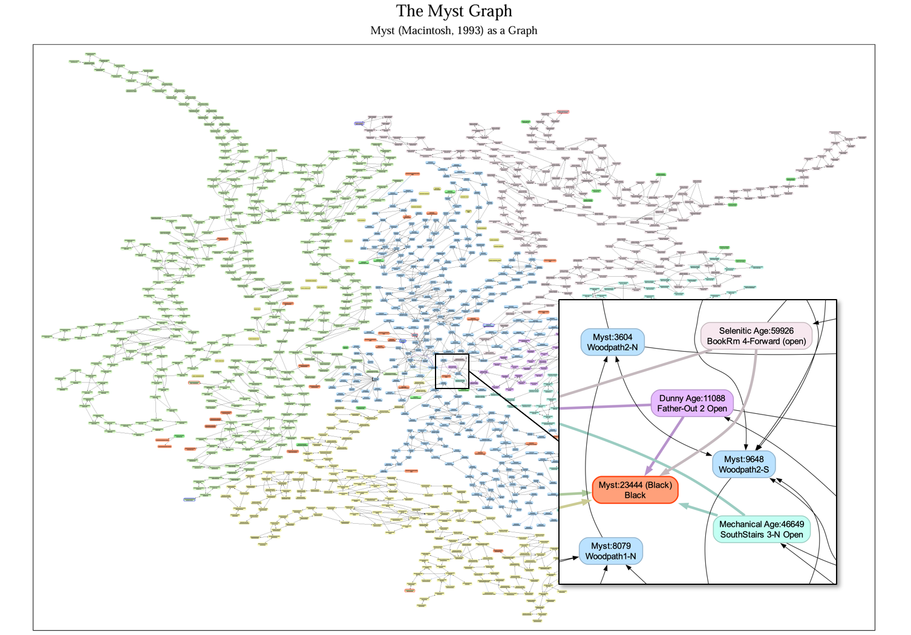

# DeMystify



DeMystify is an unofficial open-source project graph-based analysis of the classic Myst game. In other words, it represents Myst as a graph.

## The Myst Graph

The Myst Graph represents the game's cards as a network–a graph–showing how they are connected. This visualization helps us understand the game’s structure in a new way. The corrected generator produces 1,364 nodes and 3,232 non-disabled directed connections from the fresh stack conversion (3,231 from the saved XML snapshot), before reverse pairs are combined for display. The published visualization has 3,189 connections. [Graph changes](GRAPH_CHANGES.md) explains the first audit; [the second audit](AUDIT_ROUND_2.md) documents the raw-stack conversion and input difference. [Model refinements](MODEL_REFINEMENTS.md) explains the revised source definition, caller links, individual self-reference evidence and separate conditional Zip layer.

The analysis extracts links from supported HyperTalk commands without executing the scripts. Shortest paths describe the static card graph and exclude disabled and backtracking edges. They do not simulate puzzle conditions, variables, or the HyperCard return stack; restrictive-transitivity IDs associate edges visually rather than enforce stateful navigation. A graph path therefore does not guarantee a playable route through the game.

## Generate the Myst Graph

### Prerequisites

*   A 1993 Myst CD-ROM (Macintosh)
*   g++
*   [Go](https://go.dev/doc/install)
*   [Neato](https://graphviz.org/docs/layouts/neato/)
 
#### Convert the HyperCard Cards

The Myst game uses HyperCard files, which need to be converted into a format that DeMystify can understand. This is done using the `stackimport` tool.

*   **Get stackimport:** Download and install it from [https://github.com/uliwitness/stackimport](https://github.com/uliwitness/stackimport)
*   **Compile stackimport:** 

    *   **Linux:** `$ g++ -o stackimport woba.cpp Tests.cpp picture.cpp main.cpp CStackFile.cpp CBuf.cpp byteutils.cpp -std=gnu++11`
    *   **MacOS:** `$ g++ -o stackimport woba.cpp Tests.cpp picture.cpp main.cpp CStackFile.cpp CBuf.cpp byteutils.cpp snd2wav/snd2wav/snd2wav.cpp -std=gnu++11 -framework Carbon -framework CoreServices`

*   **Copy the Myst Files:** Locate the `Myst Files` directory on your CD-ROM and copy it to a writable directory (*e.g.*, `Myst_decompiled_cards`).
*   **Run stackimport:** Navigate to the directory containing the copied files and run the following commands:

    ```bash
    $ ./stackimport <path_to_stack>/Channelwood\ Age
    $ ./stackimport <path_to_stack>/Dunny\ Age
    $ ./stackimport <path_to_stack>/Mechanical\ Age
    $ ./stackimport <path_to_stack>/Myst
    $ ./stackimport <path_to_stack>/Selenitic\ Age
    $ ./stackimport <path_to_stack>/Stoneship\ Age
    ```

### Generate the Myst Graph

1.  **Navigate to the DeMystify directory**
2.  **Run DeMystify:**

    ```bash
    $ go run main.go <converted_files_directory_path>
    ```

    *   Replace `<converted_files_directory_path>` with the path to the directory where you saved the converted stack files (*e.g.*, `/Users/Atrus/Myst_decompiled_cards`).
3.  **Wait:** The graph generation process takes several minutes.
4.  **The Myst Graph is generated:** The generated DOT and PDF files will be saved in the `generated` subdirectory.

### Add the publication border, header and footer

The app generates the raw vector graph in `generated/graph.pdf`. To reproduce the original publication layout around it:

```bash
python3 -m venv /tmp/demystify-pdf
/tmp/demystify-pdf/bin/python -m pip install -r scripts/requirements-pdf.txt
/tmp/demystify-pdf/bin/python scripts/frame_graph_pdf.py generated/graph.pdf generated/myst_graph.pdf
```

The optional formatter preserves the graph at its native size and adds the original margins, Times-Roman heading, border and clickable `glthr.com` footer. Use `--date YYYY-MM-DD` to set the footer date, or `--subtitle "..."` for a path-specific graph. The raw PDF and DOT remain unchanged.

## Stay Up-to-Date

*   [The Myst Graph: A New Perspective on Myst](https://glthr.com/myst-graph-1)
*   [The Myst Graph, 2: Revealing New Findings](https://glthr.com/myst-graph-2)
*   [The Myst Graph, 3: Creating the Graph with DeMystify](https://glthr.com/myst-graph-3)

## Disclaimer

This project is a personal initiative to analyze and understand the classic Myst game. It is an unofficial and nonlucrative open-source effort created for educational purposes only. This project is not affiliated with Cyan Worlds or the original creators of Myst.

## License and Credits

DeMystify is released under the MIT License, acknowledging the original creators of Myst and Cyan Worlds for inspiring this project.
